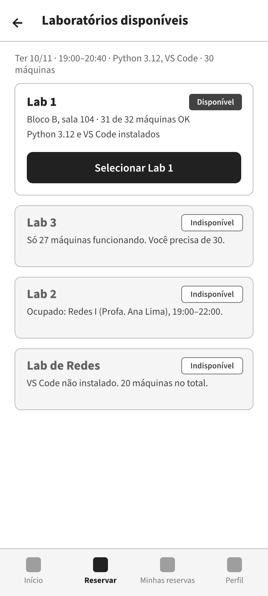
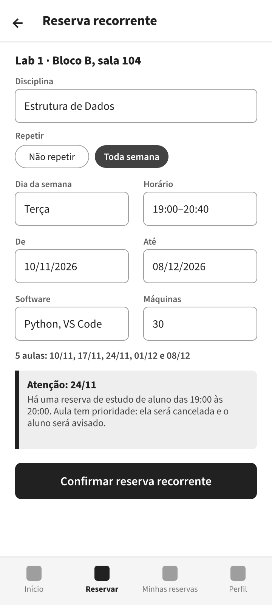
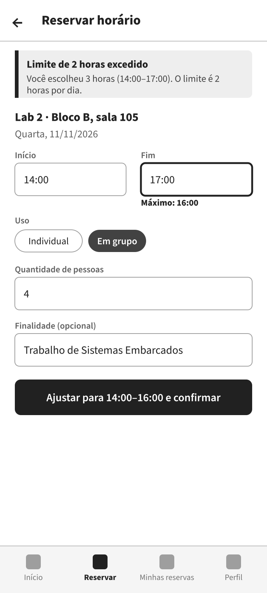
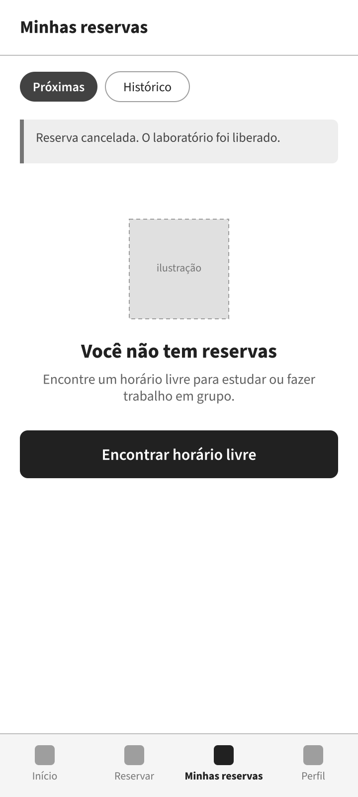
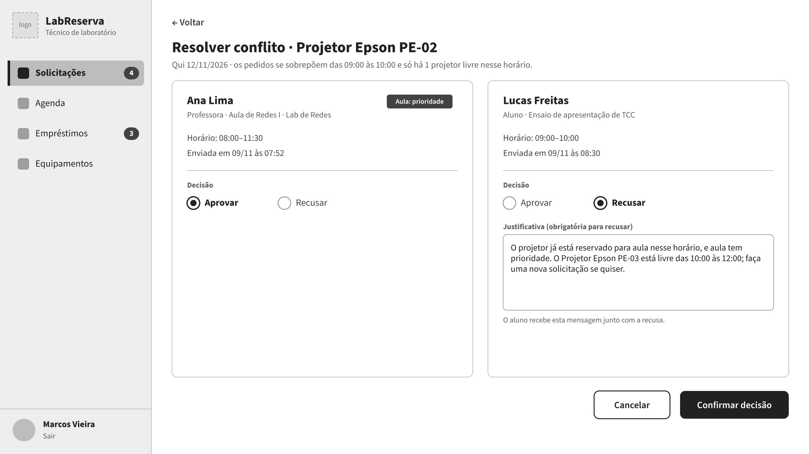
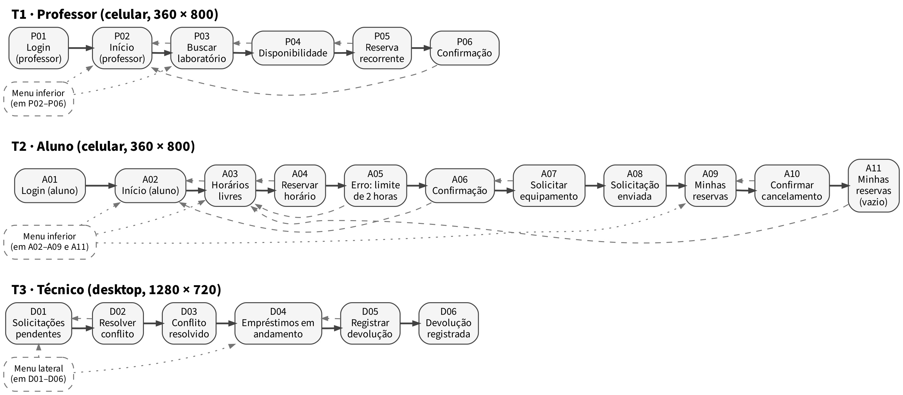

# LabReserva — Protótipo de média fidelidade

Protótipo navegável, em escala de cinza, de um sistema de **reserva de laboratórios e empréstimo de equipamentos** para uma faculdade (caso fictício: Faculdade Horizonte). Trabalho acadêmico de Interação Humano-Computador (IHC) do curso de Engenharia de Software da UniRV.

**▶ [Abrir o protótipo no Penpot](https://design.penpot.app/?screen=viewer&file-id=c6f51e89-5d00-81ce-8008-e4eafc136fb0&page-id=c6f51e89-5d00-81ce-8008-e4eafc136fb1&section=interactions&index=0&zoom=fit&share-id=28115847-11dc-4234-872a-bf97b0e21492)**. No modo de visualização, escolha o fluxo no menu superior (T1, T2 ou T3) e navegue clicando nos botões.

## O problema

Hoje as reservas são feitas por planilha e WhatsApp com o técnico. Isso gera conflitos de horário descobertos na hora da aula, falta de informação sobre software e máquinas funcionando, horários livres invisíveis para os alunos, empréstimos sem registro e um técnico sobrecarregado.

## Tarefas prototipadas

| Tarefa | Usuário | Dispositivo | O fluxo cobre |
|---|---|---|---|
| T1 | Professor | Celular (360 × 800) | Entrar, buscar laboratório por data, horário e software, ver disponibilidade, criar reserva recorrente semanal e receber confirmação |
| T2 | Aluno | Celular (360 × 800) | Entrar, encontrar horário livre, reservar para um grupo, solicitar equipamento e cancelar em "Minhas reservas" |
| T3 | Técnico | Desktop (1280 × 720) | Ver solicitações pendentes, resolver um conflito (aprovar uma e recusar outra com justificativa) e registrar a devolução de um equipamento |

São 23 telas, com estados de vazio, erro e confirmação.

## Telas principais

| T1 · Disponibilidade | T1 · Reserva recorrente | T2 · Erro (limite de 2 h) | T2 · Estado vazio |
|---|---|---|---|
|  |  |  |  |

**T3 · Resolver conflito (técnico)**

Todas as telas estão na pasta [`telas/`](telas/).

## Mapa de telas

Seta contínua: caminho da tarefa. Seta tracejada: voltar ou cancelar. Seta pontilhada: menu fixo.

## Documentação

O [relatório completo (PDF)](docs/relatorio.pdf) traz o perfil de usuário, as personas (e o antiusuário), o cenário de uso, a análise hierárquica da tarefa (HTA), as metas de usabilidade (ISO 9241-11), as decisões de design e as limitações do protótipo.

## Ferramenta

[Penpot](https://penpot.app): gratuito, de código aberto e no navegador.

## Autor

João Henrique Porfirio Firmiano, com auxílio do Claude (Anthropic).
